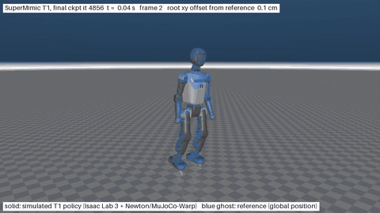

# SuperMimic on Booster T1

[](LICENSE)

An unofficial reproduction of *SuperMimic: Scaling Humanoid Whole-Body Control with One Differentiable World Model* ([arXiv 2610.28480](https://arxiv.org/abs/2610.28480)) for the Booster T1 humanoid, on Isaac Lab 3.0 (kit-less, Newton with the MuJoCo-Warp solver).

The tracking policy is trained by backpropagating a motion-tracking reward through short imagined rollouts of a learned world model. There is no PPO component.



Solid: simulated robot. Blue ghost: reference motion. The GIF shows the first 16 s; the full 32.7 s video is [media/t1_dance_final.mp4](media/t1_dance_final.mp4).

## Result at a glance

After **45 minutes of training on one RTX 3080 Ti (12 GB)**, the policy tracks the whole 32.7 s `t1_dance` clip in simulation:

| Measure | Value |
|---|---|
| Normalised return, from frame 0 over the whole clip | **0.971** |
| Normalised return, 33 starts (one per second of clip) | **0.976** |
| Failures (early terminations) | **0 of 33** |
| Mean tracked-body position error | 1.6 cm |
| Mean global trunk position error (includes drift) | 5.1 cm |
| Mean joint angle error | 0.051 rad |

This is one clip, one seed, in simulation, with training and evaluation on the same motion. It shows that the method works on the T1; it is not the paper's benchmark (40 LAFAN1 clips on a Unitree G1) and the numbers are not comparable with it. See [Limits](#limits-and-deviations).

## How it works

Each training iteration does three things:

1. **Collect.** Run the current policy in the simulator with action noise and store the transitions in a replay buffer.
2. **Fit the world model.** A deterministic MLP (3 × 2048) learns to predict the next robot state from state, action and domain-randomisation context, trained on 8-step autoregressive windows.
3. **Improve the policy through the model.** Freeze the world model, start 32-step imagined rollouts from buffer states, and backpropagate the tracking reward through the whole rollout into the policy. A small critic supplies the value beyond the horizon.

The reward, terminations and observation layout follow BeyondMimic. The simulator is only ever used to generate data; no gradient passes through it.

## Results in detail

All numbers below come from one run (seed 0). Settings: 2048 environments, 2048 imagined rollouts of 32 steps, bf16 autocast, `torch.compile`.

### Validation checks

| Check | Result |
|---|---|
| Forward kinematics vs simulator, all 24 links, 512 envs × 4 trials | max error 9.8e-7 m, 7.0e-7 rad |
| World model alone, 3000 iterations, held-out 8-step normalised error | 0.409 → 0.035 |
| World model alone, 8-step position error | 7.5 mm → 1.4 mm |
| World model alone, 8-step joint error | 0.014 rad → 0.003 rad |

### Training curve

Simulator-side numbers (not imagined), measured on the training environments with action noise. The policy starts training at iteration 500; before that only the world model is fit.

| Iteration | Wall-clock | Normalised episode return | Episodes terminated early | World-model 8-step error |
|---|---|---|---|---|
| 500 | 3 min | 0.45 | 98% | 0.093 |
| 1000 | 8 min | 0.59 | 2% | 0.438 |
| 1500 | 12 min | 0.86 | 0% | 0.080 |
| 2000 | 17 min | 0.90 | 0% | 0.055 |
| 3000 | 27 min | 0.92 | 0% | 0.043 |
| 4000 | 36 min | 0.92 | 0% | 0.033 |
| 4850 | 45 min | 0.92 | 0% | 0.031 |

The world-model error rises when the policy first moves the robot into states the model has not seen, then recovers as new data arrives. At the end, the per-step reward is 0.956 in imagination and 0.929 in the simulator, so the policy is not exploiting model errors to any large degree.

### Compute

| Measure | Value |
|---|---|
| Iterations completed in 45 min | 4856 |
| Simulator steps collected | 25.0 million |
| Speed | 1.74 iterations/s |
| Peak GPU memory | 5.99 GiB allocated by PyTorch, 9.4 GB on the card |

Time per iteration (about 580 ms):

| Phase | Time | Share |
|---|---|---|
| World-model update | 249 ms | 43% |
| Imagined rollout, backward pass | 122 ms | 21% |
| Imagined rollout, forward pass | 88 ms | 15% |
| Simulator collection | 72 ms | 12% |
| Critic update | 48 ms | 8% |

## Limits and deviations

- **Single clip.** Training and evaluation use the same motion, so generalisation is not tested.
- **Lenient reward.** A return of 0.97 is not near-perfect imitation; the video shows visible differences in the arms at some points.
- **No baseline.** No model-free (PPO) run has been done on the same clip, so there is no speed comparison yet.
- **No actuator delay.** Booster's stock T1 configuration uses a random 2 to 8 step command delay; here it is zero.
- **Self-collisions are off.**
- **Smaller batch than the paper.** 2048 imagined rollouts instead of 4096, to fit in 12 GB.
- **Reference quality.** The clip's frame rate is assumed to be 50 fps (the file does not state it), and its arm poses exceed the T1 joint limits in 2.9% of (frame, joint) entries.
- **Review status.** The code passes the checks above but has not had an independent line-by-line review.
- **Simulation only.** Nothing here has run on a real robot.

## Setup

Requirements: Linux, an NVIDIA GPU with 12 GB or more, and Isaac Lab 3.0.0 with `isaaclab_newton`, `newton`, `mujoco-warp` and PyTorch. Tested with Isaac Lab 3.0.0, newton 1.6.0, mujoco-warp 3.12.0, warp-lang 1.17.0 and torch 2.12.

Booster's robot description and motion data are not redistributed here. Clone [booster_assets](https://github.com/BoosterRobotics/booster_assets) and point `BOOSTER_ASSETS_DIR` at it (default `~/booster_assets`).

```sh
export BOOSTER_ASSETS_DIR=/path/to/booster_assets
export PYTHONPATH=$PWD
PY=/path/to/IsaacLab/.venv/bin/python

$PY supermimic_t1/tools/make_assets.py          # writes data/t1/: mesh-free MJCF, USD, ground
$PY supermimic_t1/tools/test_fk.py --num_envs 512 --trials 4 --out logs/gate1_fk.json
```

## Train and evaluate

```sh
# world model only (sanity check, about 15 minutes)
$PY supermimic_t1/train.py --policy_mode zero --iterations 3000 --num_envs 2048 --wm_batch 2048 \
    --log_every 50 --ckpt_every 1000 --log_dir logs/wm_only

# full training, 45 minutes
$PY supermimic_t1/train.py --num_envs 2048 --pi_batch 2048 --wm_batch 2048 --wall_minutes 45 \
    --log_every 50 --ckpt_every 500 --log_dir logs/dance

# evaluate the final checkpoint and summarise the training log
$PY supermimic_t1/evaluate.py --ckpt logs/dance/last.pt --out logs/dance/eval_last
python3 supermimic_t1/tools/summarize.py logs/dance/train_log.csv
```

`evaluate.py --record` saves a trajectory that `supermimic_t1/tools/render.py` turns into a video with MuJoCo (EGL).

## Repository layout

| Path | Contents |
|---|---|
| `supermimic_t1/train.py` | Training loop: collect, fit world model, policy and critic update |
| `supermimic_t1/networks.py` | World model, policy (goal encoder and decoder) and critic |
| `supermimic_t1/mdp.py` | Observation, reward and termination, shared by the simulator and the world model |
| `supermimic_t1/env.py` | Vectorised tracking simulator on Newton / MuJoCo-Warp |
| `supermimic_t1/robot.py`, `kinematics.py`, `state.py` | T1 constants, differentiable forward kinematics, state layout |
| `supermimic_t1/motion.py`, `buffer.py`, `reset_sampling.py` | Reference motion, replay buffer, reset sampling |
| `supermimic_t1/evaluate.py` | Deterministic evaluation and trajectory recording |
| `supermimic_t1/tools/` | Asset generation, kinematics and environment tests, log summary, renderer |

## Roadmap

- A PPO baseline on the same clip and the same GPU.
- More motions (LAFAN1 retargeted to the T1), to test one policy across many clips.
- Actuator delay as part of the modelled state.
- Hand-written GPU kernels for the kinematics and reward inside the imagined rollout; the candidate spots are marked `# GPU-KERNEL-CANDIDATE` in the code.

## Citation

If you use this code, please cite the original paper:

```bibtex
@article{liao2026supermimic,
  title   = {SuperMimic: Scaling Humanoid Whole-Body Control with One Differentiable World Model},
  author  = {Liao, Qiayuan and Shao, Yiyang and Long, Junfeng and Zakka, Kevin and Horowitz, Roberto and Abbeel, Pieter and Sreenath, Koushil},
  journal = {arXiv preprint arXiv:2610.28480},
  year    = {2026}
}
```

## Credits and licences

- Method: Liao et al., *SuperMimic*, 2026. This repository is not affiliated with the authors.
- Parts of the code are adapted from [supermimic_vibed](https://github.com/zita-ch/supermimic_vibed) by Chong Zhang (MIT). See [THIRD_PARTY_NOTICES](THIRD_PARTY_NOTICES).
- Robot description and motion: Booster Robotics `booster_assets` (BSD-3-Clause); actuator constants from `booster_train` (Apache-2.0). Neither is redistributed.
- This repository is released under the [MIT License](LICENSE).
